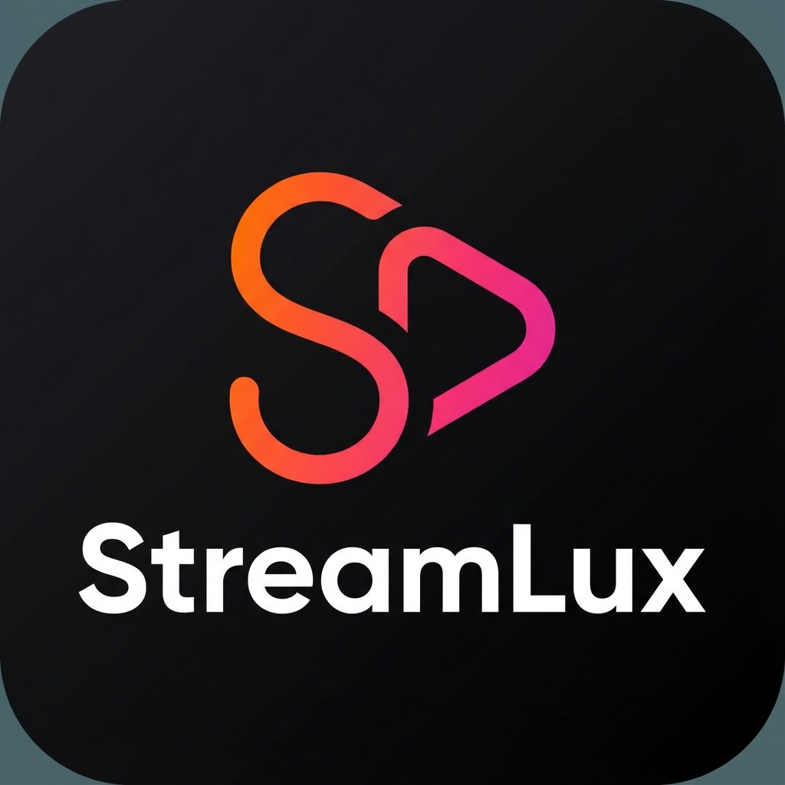
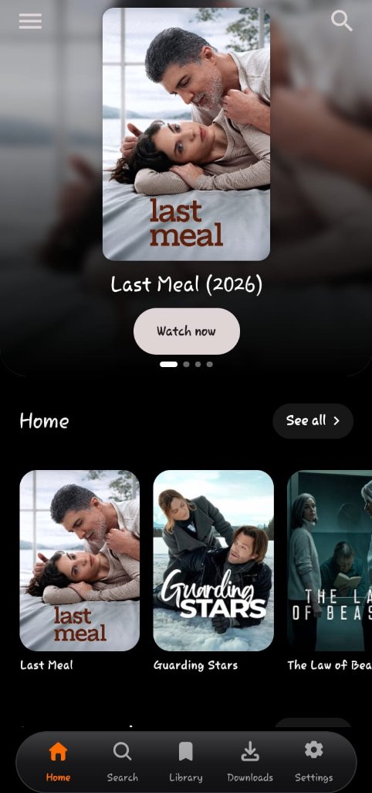
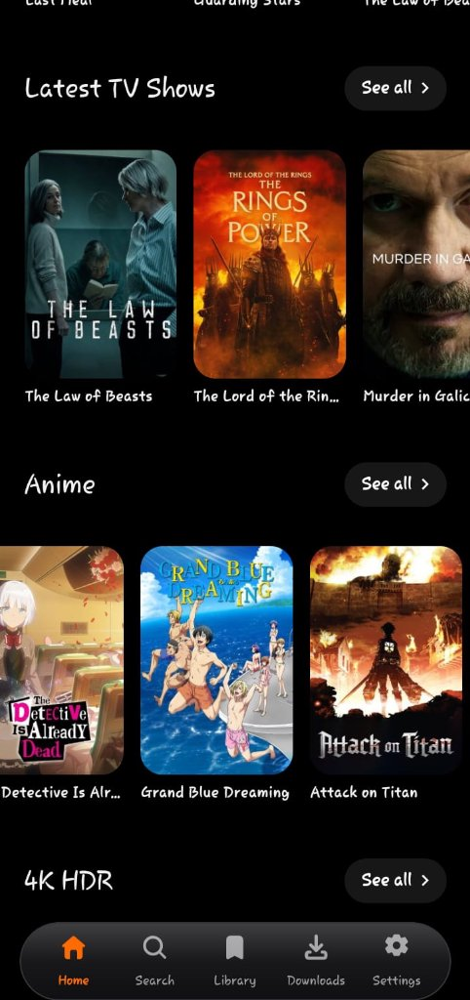
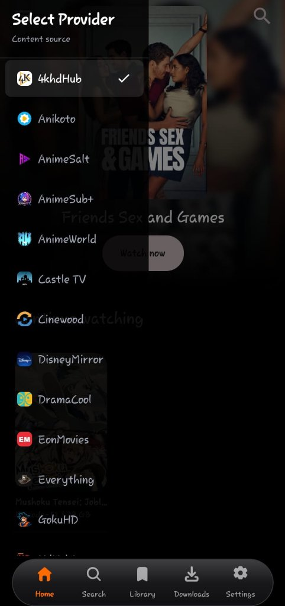
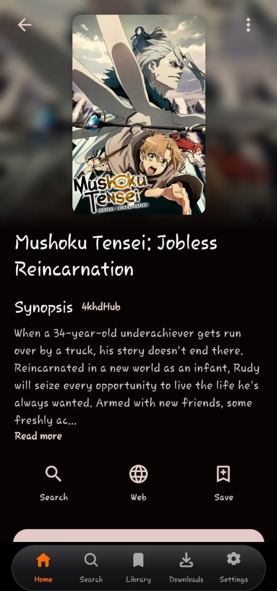
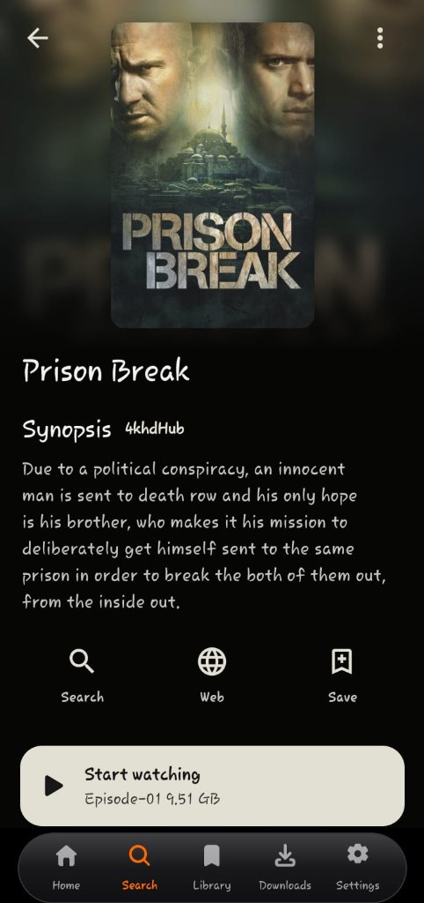
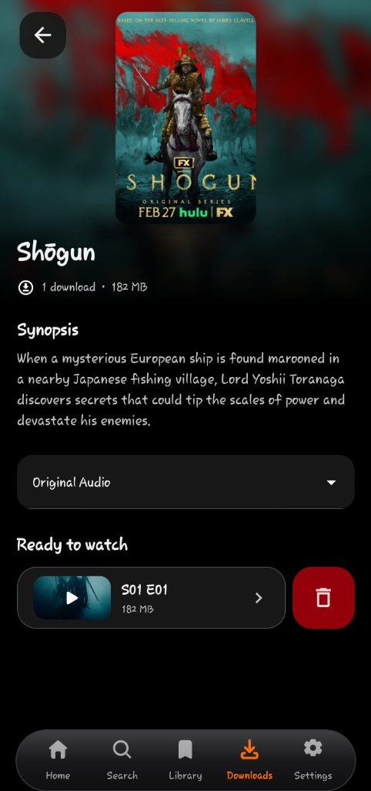
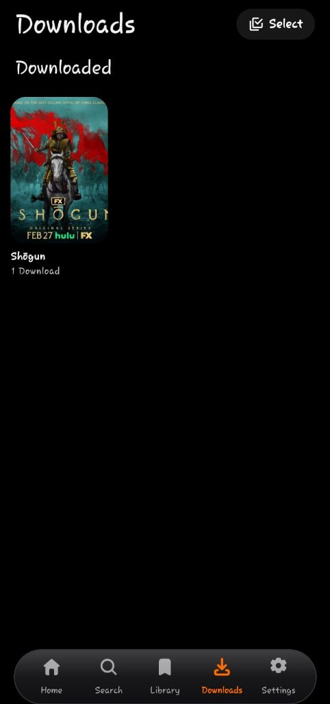
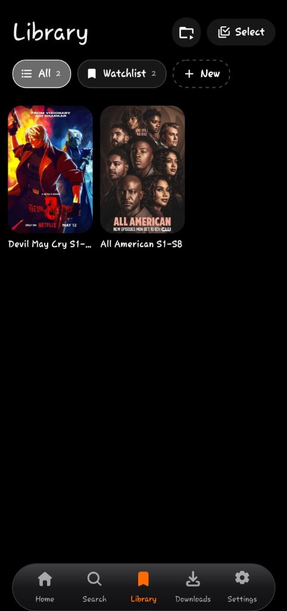

<div align="center">



# STREAMLUX

**The Ultimate Free Streaming App for Android**

*Movies · TV Shows · Anime · 4K HDR · Downloads*

[](https://github.com/gideongeny/STREAMLUX/releases/latest)
[](https://github.com/gideongeny/STREAMLUX/releases/latest)
[](https://github.com/gideongeny/STREAMLUX)

---

### ⬇️ Download StreamLux v5.0.6

| Platform | Link |
|:---:|:---:|
|  | [**Download APK**](https://github.com/gideongeny/STREAMLUX/releases/download/streamlux-v5.0.6/streamlux-v5.0.6.apk) |
|  | [**View on Google Play**](https://play.google.com/store/apps/details?id=com.streamlux.app.mobile) |
|  | [**GitHub Releases**](https://github.com/gideongeny/STREAMLUX/releases) |

</div>

---

## 📱 Screenshots

<div align="center">

| Home — Featured | Home — Categories | Provider Selection |
|:---:|:---:|:---:|
|  |  |  |

| Media Detail — Anime | Media Detail — Series | Download Detail |
|:---:|:---:|:---:|
|  |  |  |

| Downloads Screen | Library |
|:---:|:---:|
|  |  |

</div>

---

## ✨ What's New in v5.0.6 — Liquid Glass Edition

- 🪟 **Liquid Glass UI** — Apple-inspired frosted glass morphism across the entire app
- 💊 **Translucent Pill Navigation Bar** — Fully floating, full-width pill nav with blur effects
- 🎨 **Redesigned Settings** — Brand-new StreamLux-exclusive settings layout with section icons
- 🔄 **Multi-Provider Engine** — 20+ streaming providers in one unified interface
- ⬇️ **Offline Downloads** — Download episodes and movies for offline viewing
- 📺 **4K HDR & Anime** — Dedicated category rows for 4K HDR content and Anime
- 🏠 **Dynamic Hero Carousel** — Auto-rotating featured content with smooth transitions
- 📚 **Smart Library** — Watchlist, Continue Watching, and Downloaded sections
- 🛡️ **AntiDPI Mode** — Bypass ISP blocking without a VPN (port 36645)
- 🌐 **WARP VPN Mode** — Cloudflare WARP integration for extra privacy
- 🔌 **Provider Manager** — Install, update, and test provider extensions on-the-fly
- 📡 **Chromecast Support** — Cast to your TV with one tap
- 🤖 **Android TV Ready** — Full D-pad navigation support

---

## 🚀 Features

### 🎬 Content
- **Movies** — Browse thousands of movies from multiple providers
- **TV Shows** — Full series with per-episode streaming
- **Anime** — Dedicated anime section powered by Anikoto, AnimeSalt, AnimeSub+, AnimeWorld
- **4K HDR** — Premium quality streams via 4khdHub and other HD providers
- **Sports** — Live sports and replays

### 🎨 Design
- Liquid Glass morphism UI inspired by modern design trends
- Full-screen blurred backdrop on media detail pages
- Floating translucent pill navbar with frosted glass
- StreamLux orange accent (`#FF6B00`) throughout

### ⚙️ Technical
- **Multi-source scraping** — 20+ providers: 4khdHub, Anikoto, AnimeSalt, Castle TV, Cinewood, DisneyMirror, DramaCool, EonMovies, GokuHD, and more
- **ExoPlayer** — Hardware-accelerated video playback
- **Background downloads** — Queue and download in the background
- **Auto-update checking** — Checks for new GitHub releases on startup
- **AntiDPI bypass** — Built-in ISP circumvention on port 36645
- **Cloudflare WARP VPN** — Optional privacy layer

---

## 📦 App Info

| Field | Value |
|---|---|
| **Package Name** | `com.streamlux.app.mobile` |
| **Version** | 5.0.6 (Build 65) |
| **Edition** | Liquid Glass Edition |
| **Min Android** | Android 6.0 (API 23) |
| **Target Android** | Android 14 (API 34) |
| **APK Size** | ~57 MB |
| **APK SHA-256** | `6981814243BB6C6A630AFB1C331792A81DD601EEF1DDFCEFC4B3954DE721A3E3` |

---

## 🔧 Installation

### Via APK (Sideload)
1. [Download the APK](https://github.com/gideongeny/STREAMLUX/releases/download/streamlux-v5.0.6/streamlux-v5.0.6.apk)
2. On your Android device, go to **Settings → Security → Unknown Sources** and enable it
3. Open the downloaded APK and tap **Install**
4. Launch **StreamLux** and enjoy!

### Via Google Play
Search for **StreamLux** on Google Play or [tap here](https://play.google.com/store/apps/details?id=com.streamlux.app.mobile).

### Via Orion Store / F-Droid-like stores
Use the GitHub repo URL (without `.git`):
```
https://github.com/gideongeny/STREAMLUX
```
Or the direct release tag: `streamlux-v5.0.6`

---

## 🌐 Links

| Resource | URL |
|---|---|
| 🌍 Website | [streamlux.app](https://streamlux.app) |
| 🎮 Google Play | [play.google.com/store/apps/details?id=com.streamlux.app.mobile](https://play.google.com/store/apps/details?id=com.streamlux.app.mobile) |
| 📦 GitHub Releases | [github.com/gideongeny/STREAMLUX/releases](https://github.com/gideongeny/STREAMLUX/releases) |
| 🐛 Report Issues | [github.com/gideongeny/STREAMLUX/issues](https://github.com/gideongeny/STREAMLUX/issues) |

---

## 🛠️ Tech Stack

| Layer | Technology |
|---|---|
| Framework | React Native + Expo 57 |
| Video Player | ExoPlayer (via expo-av) |
| Navigation | React Navigation 6 (Pill Nav) |
| UI | Custom Liquid Glass components |
| Networking | Axios + Cheerio (web scraping) |
| Storage | AsyncStorage + SQLite |
| Ads | Google AdMob (paced) |
| Build | EAS Build (Android AAB/APK) |

---

## 📄 Disclaimer

StreamLux is a **free, open-source** streaming aggregator. It does not host any content. All streams are sourced from publicly accessible third-party providers. Use responsibly and in accordance with the laws in your country.

---

<div align="center">

Made with ❤️ by the StreamLux Team · v5.0.6 Liquid Glass Edition

[](https://github.com/gideongeny/STREAMLUX/releases/download/streamlux-v5.0.6/streamlux-v5.0.6.apk)

</div>
